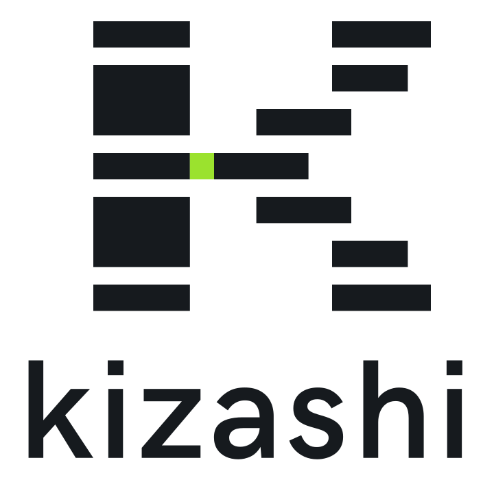

<p align="center">
  <picture>
    <source media="(prefers-color-scheme: dark)" srcset="assets/brand/kizashi-logo-dark.svg">
    
  </picture>
</p>

<p align="center"><b>遅れの「兆し」を先に見つけ、報告ではなく対応に時間を使うための、1ファイルで動くPMOツール。</b><br>
A free, zero-install PMO tool that spots the early signs of delay. (English below)</p>

<p align="center">
  <a href="https://matassy0813.github.io/kizashi/Kizashi.html"><b>▶ 今すぐ試す（ダウンロード不要） / Try it now</b></a> ·
  <a href="https://github.com/matassy0813/kizashi/raw/main/Kizashi.html">ダウンロード / Download</a> ·
  <a href="#ライセンス">AGPL-3.0</a>
</p>

---

## 特長

- **インストール不要**：`Kizashi.html` をダブルクリックするだけで動きます（約370KB、起動は約0.2秒）
- **データは外に出ない**：すべてのデータはあなたのブラウザの中だけに保存され、サーバーには送信されません
- **日本語／English**：画面右上で切り替え。週次報告は画面とは別に言語を選べます
- **導入の手間が小さい**：3ステップの「はじめかた」で、フェーズ・マイルストーン・ガバナンスの雛形・定例会議・体制図まで自動で作成。ExcelのWBSはCSVで取り込めます

## できること

| 機能 | 内容 |
|---|---|
| ダッシュボード | 全体ステータス（Red/Amber/Green）、進捗と計画、SPI、ガント、警戒、会議・ガバナンスの状況 |
| 早期警戒 | 期限超過・進捗遅延・リスケの常態化・更新停滞・負荷集中・契約期間超過など20種類以上を自動判定 |
| タスク | 種類別のステータス（一般／検討／開発／成果物）、承認で自動クローズ、カンバン、Backlog、次フェーズへの繰越・保留・見送り、優先度 |
| フェーズ | 契約形態・契約終了日・成果物・完了基準・フェーズゲート |
| リスク・課題（RAID） | フェーズ・カテゴリ別の管理、対策のない高リスクを警戒 |
| 会議 | 目的と担当付きアジェンダ → 結論・決定事項・アクションの記録、招集案内・議事録のコピー |
| 体制図とフロー | 木構造／所属の列の組織図、CR・承認・エスカレーションのフロー（分岐・差し戻し可）、ノーコードで線とノードを編集 |
| ガバナンス | フォルダ構成・命名規則・承認ステップ・CR基準など全フェーズ共通のルール、命名ルールツール |
| 週次レポート | 数値・警戒・リスク・会議の決定事項から自動作成（日英）、Markdown・印刷/PDF |
| ロールとログイン | PM／PMO／リード／メンバー／閲覧者。各自の画面は独立（PMも他人の画面には入れない） |
| 複数プロジェクト | 会社コード › チームコード › PJコードで区分けして切り替え |
| ヘルプ | 画面右上の「？」または `?` キーで、今いる画面の説明をすぐ表示 |

## 使い方

1. **ブラウザで開く**：[今すぐ試す](https://matassy0813.github.io/kizashi/Kizashi.html)（データはそのブラウザの中だけに保存されます）
   - または、このリポジトリの `Kizashi.html` をダウンロードしてダブルクリックで開く（オフラインでも動きます）
2. 最初はサンプルデータが入っています。パスコードなしで、どの立場（PM・メンバーなど）でも試せます
3. 自分のプロジェクトは、左上のプロジェクト名 →「新しいプロジェクト」から3ステップで作れます

### チームで使う（ローカル版）

PMが「設定・データ」→「JSONでバックアップ」で書き出したファイルを共有し、受け取った人はログイン画面の「受け取ったデータ（JSON）を読み込む」で読み込みます。同じプロジェクトなら最新に更新、違えば新しいプロジェクトとして追加されます。

> ローカル版のパスコードは「誤操作を防ぐ」ための仕組みです。サーバー側での本人確認・権限管理が必要な場合はクラウド版（計画中）を利用してください。

## 開発者向け

```
index.html        開発用（js/・assets/ を読み込む）
js/               機能ごとのファイル（core.js：データ・警戒ルール、diagram.js：図の編集部品 ほか）
assets/app.css    スタイル
build.py          配布用の1ファイル版 Kizashi.html を作る
tests/smoke.js    機能チェック（既存機能が消えていないかを確認）
LICENSE           AGPL-3.0 本文 / COMMERCIAL.md 商用ライセンス / CONTRIBUTING.md・CLA.md 貢献のルール
```

- 1ファイル版の作成：`python build.py`
- 機能チェック：ツールを開いてブラウザのコンソールに `tests/smoke.js` の内容を貼り付け、`runSmoke()` を実行（全項目OKを確認してから変更を取り込む）
- 設計の心得：機能は独立させる／既存機能は消さずに追加して切り替える／やむを得ず変えるときは理由を記録する

## ロゴ

ロゴは `assets/brand/` にあります（通常版・ダークモード版・小さいサイズ用）。名称「Kizashi」とロゴは著作者の商標で、AGPL の許諾には含まれません。

## ライセンス

このソフトウェアは **GNU Affero General Public License v3.0 のみ（AGPL-3.0-only）** で提供します（[LICENSE](LICENSE)）。個人・企業を問わず無料で利用できます。

- 改変版を配布する場合や、ネットワーク経由のサービスとして提供する場合は、AGPL に従い、改変後のソースコードを同じライセンスで公開する必要があります
- ソースコードを公開せずに改変・組み込み・SaaS 提供を行いたい場合や、個別のアドオン開発を依頼したい場合は、**商用ライセンス**をご利用ください（[COMMERCIAL.md](COMMERCIAL.md)）
- 本ソフトウェアの名称とロゴは著作者の商標であり、改変版には使用できません
- 貢献（プルリクエスト）には [CLA](CLA.md) への同意が必要です（[CONTRIBUTING.md](CONTRIBUTING.md)）

Copyright (C) 2026 0kaka

---

## English

**Kizashi** ("sign / early indication" in Japanese) is a zero-install, single-file project-management-office tool that spots the early signs of delay.

- **No install**: open `Kizashi.html` (≈370 KB, starts in ≈0.2 s)
- **Your data never leaves your browser**: nothing is sent to a server
- **Japanese / English** UI; status reports can be generated in either language
- **Early warning** (20+ rules), **kanban with typed status flows and approvals**, **phases & contracts**, **RAID**, **meetings with outcomes and actions**, **org charts and no-code flow editor**, **governance rules**, **auto-generated weekly reports**, **roles with independent sign-in**, **multiple projects grouped by company › team › project code**, and built-in **help** (press `?`)

### Quick start

1. Open it in your browser: [Try it now](https://matassy0813.github.io/kizashi/Kizashi.html) — or download `Kizashi.html` and open it locally (works offline)
2. Sample data is loaded — sign in as any role without a passcode to explore
3. Create your own project from the project menu (top left) → "New project" (3 steps)

### Development

`index.html` loads `js/` and `assets/` for development. Run `python build.py` to produce the single-file `Kizashi.html`. Run `runSmoke()` from `tests/smoke.js` in the browser console before merging changes — every check must pass.

### License

Licensed under **AGPL-3.0-only** ([LICENSE](LICENSE)) — free for individuals and companies. If you distribute a modified version or offer it over a network, you must publish your modified source under the same license. For closed-source modification, embedding, SaaS, or custom add-ons, see the **commercial license** ([COMMERCIAL.md](COMMERCIAL.md)). The name and logo are trademarks of the author and may not be used for modified versions. Contributions require agreeing to the [CLA](CLA.md) ([CONTRIBUTING.md](CONTRIBUTING.md)).

Copyright (C) 2026 0kaka
